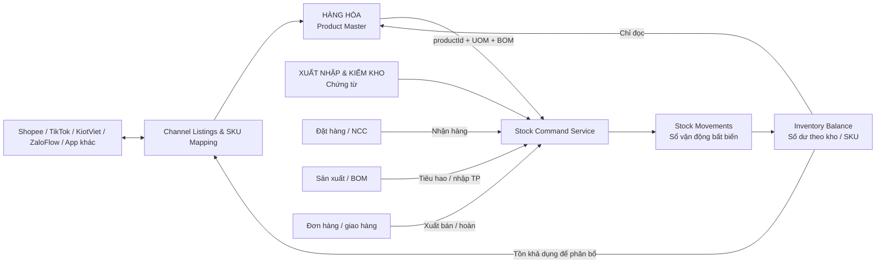
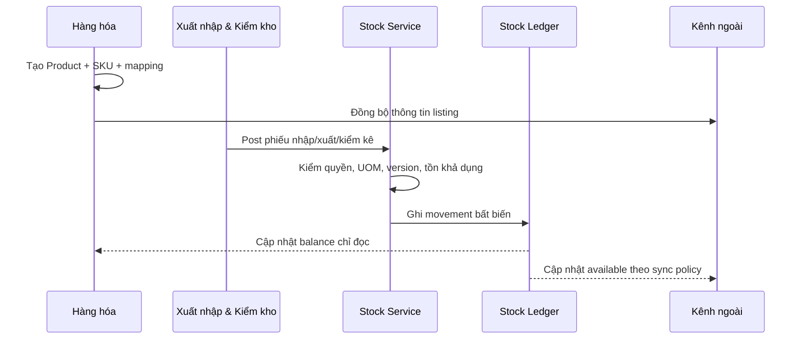

# KIỂM TOÁN LOGIC NGHIỆP VỤ CHUYÊN SÂU — RF WORKSPACE PRO

Ngày: 27/10/2026  
Trạng thái: thay thế các kết luận kiến trúc kho trong báo cáo sơ bộ.  
Nguyên tắc đã chốt:

- **Tab Hàng hóa đứng riêng**: Product Master + Integration Hub cho app/kênh ngoài.
- **Tab Xuất Nhập & Kiểm Kho đứng riêng**: chứng từ vận động kho, kiểm kê và cân bằng.
- Hai tab liên kết bằng `productId/SKU`, nhưng không nhập làm một.

## 1. Ranh giới nghiệp vụ đúng

### Hàng hóa

Sở hữu các thuộc tính tương đối ổn định:

- productId nội bộ bất biến;
- SKU chuẩn, barcode, tên chuẩn, thương hiệu, danh mục;
- đơn vị cơ sở và quy đổi đơn vị;
- giá vốn chuẩn/tham chiếu, giá bán niêm yết;
- ảnh, media, model 3D, BOM và thuộc tính kỹ thuật;
- mapping SKU của Shopee, TikTok, KiotViet, ZaloFlow và app tương lai;
- chính sách đồng bộ từng kênh, trạng thái kết nối, lỗi đồng bộ.

Không được trực tiếp sở hữu nghiệp vụ nhập, xuất, kiểm kê, hoàn kho hoặc ghi đè tồn vật lý từ số lượng của một kênh ngoài.

### Xuất Nhập & Kiểm Kho

Sở hữu các sự kiện làm thay đổi tồn:

- nhập mua hàng;
- nhập thành phẩm;
- xuất BOM/sản xuất;
- xuất bán/lấy hàng có sẵn;
- xuất hủy/thanh lý;
- hoàn kho;
- kiểm kê và bút toán cân tăng/cân giảm;
- đặt hàng, nhận hàng và trạng thái chứng từ;
- lịch sử, đảo chứng từ và truy vết người duyệt.

`Products.quantity` chỉ nên là **số dư dẫn xuất/cache**, không phải trường được nhiều màn hình tự do ghi trực tiếp.

## 2. Sơ đồ logic mục tiêu



Mọi thay đổi tồn phải đi qua `Stock Command Service`; tab Hàng hóa chỉ đọc số dư và quản lý master/mapping.

## 3. Các lỗi logic kho đang có

### P0. Hàng hóa đang sửa tồn trực tiếp

`ProductEditModal.handleSave` lấy `form.quantity`, tính `_diff`, rồi ghi `Products`. Điều này trộn hai trách nhiệm:

- sửa master data;
- tạo biến động kho.

Không có lý do chứng từ, kho nguồn/đích, loại nghiệp vụ hay liên kết chứng từ. Nếu người dùng sửa tên/ảnh cùng lúc với quantity, một thao tác master có thể âm thầm tạo chênh lệch tồn.

**Sửa:** bỏ trường chỉnh quantity khỏi modal Hàng hóa. Nếu cần “điều chỉnh tồn”, nút phải mở chứng từ ở tab Xuất Nhập & Kiểm Kho.

### P0. Nhập danh mục Shopee ghi đè tồn nội bộ bằng tồn của sàn

`ShopeeProductImportModal` tạo/cập nhật `Products` với `quantity` lấy từ dữ liệu Shopee. Tồn sàn là tồn công bố hoặc tồn listing, không đồng nghĩa tồn vật lý toàn hệ thống.

Hậu quả:

- import lại danh mục có thể ghi đè tồn kho thật;
- nhiều shop cùng SKU không có cách cộng/trừ hợp lệ;
- không biết số lượng nào đến từ kênh nào;
- không có lịch sử điều chỉnh.

**Sửa:** import Shopee chỉ upsert `ChannelListing` và mapping tới `productId`; quantity của sàn lưu ở `channelAvailableQty`, không ghi `Products.quantity`.

### P0. Tab Hàng hóa có thao tác Nhập/Xuất một chạm

`handleExecuteStockAdj` nằm trong Inventory/Hàng hóa, tự tính số dư mới và đồng thời tạo phiếu ImportExport. Dù có phiếu, đây vẫn là logic chứng từ đặt sai miền và có lỗi che giấu thiếu hàng:

```text
newQty = Math.max(0, currentQty + delta)
```

Nếu xuất vượt tồn, hệ thống hạ về 0 thay vì báo thiếu; phiếu vẫn ghi toàn bộ số lượng xuất. Sổ vận động và số dư có thể lệch nhau.

**Sửa:** chuyển thao tác này sang tab Xuất Nhập; server từ chối hoặc đưa vào hàng chờ âm kho theo policy, tuyệt đối không clamp im lặng.

### P0. Hoàn kho hàng hoàn tăng tồn nhưng không ghi sổ vận động

`handleResolveReturn('RESTOCK')` cập nhật `Orders.returnStatus` và cộng `Products.quantity`, nhưng không tạo `ImportExport/StockMovement` tương ứng.

Hậu quả: số dư tăng mà không thể truy ra phiếu nhập hoàn, người kiểm kho không giải thích được chênh lệch.

**Sửa:** tạo chứng từ `RETURN_RESTOCK` bất biến, liên kết `orderId`, `returnTrackingCode`, ảnh kiểm định và người duyệt.

### P0. Hiện có hai engine kiểm kho khác nhau

1. `IEFormModal(type='Kiểm Kho')`:
   - kiểm theo `sub_category`;
   - tạo hai phiếu `IE_GCHK_N_*` và `IE_GCHK_X_*`;
   - ghi Products ngay.

2. `StockTakeKiotVietView` trong Tab_Inventory:
   - có draft/BALANCED/CANCELLED;
   - tạo một phiếu type `Kiểm Kho` với metadata JSON trong `note`;
   - cân bằng sau hoặc cân ngay.

Đây không phải chỉ trùng UI: hai engine tạo **hai định dạng chứng từ, hai lifecycle và hai cách truy vấn kiểm kho**.

**Sửa:** giữ một engine kiểm kho duy nhất trong tab Xuất Nhập & Kiểm Kho. Tab Hàng hóa chỉ có liên kết “Xem lịch sử tồn” hoặc “Tạo yêu cầu kiểm SKU này”.

### P0. Cân bằng phiếu kiểm có thể sai khi dữ liệu thay đổi giữa lúc đếm và lúc duyệt

Phiếu lưu `systemQty` và `actualQty`, sau đó khi cân bằng gửi `_diff = actualQty - systemQty`. Backend cộng `_diff` vào số dư hiện tại. Nếu giữa lúc tạo phiếu và duyệt có nhập/xuất mới, kết quả không còn phản ánh số đếm tại thời điểm nào rõ ràng.

Ví dụ: sổ lúc đếm 10, thực tế đếm 8 ⇒ diff -2. Sau đó nhập 5 làm sổ thành 15. Duyệt phiếu sẽ còn 13; không phải 8 và cũng không phải tồn thực tế mới được tái đếm.

**Sửa:** phiếu phải có `countedAt`, `stockVersion` hoặc cutoff movement ID. Khi duyệt, server phát hiện movement mới sau cutoff và bắt tái xác nhận/recount, không âm thầm cộng diff cũ.

### P0. Phiếu PO trong tab Nhà cung cấp được ghi là “Nhập” nhưng không tăng tồn

`Tab_Suppliers.handleSavePO` tạo `ImportExport` type `Nhập`, tạo công nợ/thanh toán, nhưng không cập nhật Products. Như vậy chứng từ nói đã nhập kho trong khi số dư không đổi.

Nghiệp vụ đang nhập nhằng giữa:

- Purchase Order — đặt mua;
- Goods Receipt — nhận hàng;
- Supplier Invoice — ghi nhận phải trả;
- Payment — thanh toán.

**Sửa:** PO phải là `ORDERED`, không tác động tồn. Chỉ thao tác “Nhận hàng” trong tab Xuất Nhập mới sinh Goods Receipt và Stock Movements. Công nợ phát sinh theo chính sách lúc nhận hóa đơn/nhận hàng, không theo tên phiếu “Nhập” giả.

### P0. Xóa/sửa phiếu kho đảo tồn bằng tên hàng

Các luồng xóa, sửa, xác nhận nhận hàng tìm Product bằng `x.name === item.name`. Khi Hàng hóa đổi tên, phiếu cũ không còn khớp; hoặc hai SKU cùng tên có thể đảo nhầm mặt hàng.

**Sửa:** mọi dòng chứng từ bắt buộc có `productId`, `skuSnapshot`, `nameSnapshot`, `uom`, `baseQty`. Logic chỉ join bằng `productId`; snapshot dùng để in lịch sử.

### P0. Cho xóa vĩnh viễn chứng từ đã tác động tồn

`handleDelete` xóa phiếu ImportExport, cố đảo tồn, rồi tìm giao dịch liên quan bằng `note.includes(log.id)` hoặc fuzzy theo tên/ngày. Đây là mô hình nguy hiểm cho kiểm toán.

**Sửa:** chứng từ đã posted không được hard-delete hoặc sửa dòng. Phải tạo `REVERSAL` liên kết `reversalOf`, rồi tạo chứng từ thay thế. Chỉ draft chưa post mới được xóa.

### P1. Schema ImportExport làm rơi dữ liệu nghiệp vụ

Schema backend hiện chỉ có:

`id, type, target, totalAmount, date, note, itemsData`

Frontend gửi thêm `otherFees`, `isPaid`, `paidAmount`, `debtAmount`, `createdAt` nhưng formatter/schema không bảo đảm lưu các trường này. Một số dữ liệu chỉ tồn tại trong callback/UI rồi biến mất khi tải lại.

**Sửa:** chuẩn hóa header chứng từ và tách bảng dòng chứng từ; không nhét toàn bộ nghiệp vụ vào `note/itemsData` JSON.

### P1. Nợ nhà cung cấp là số cộng dồn có thể mất cập nhật

Frontend đọc `supplier.totalDebt`, cộng số mới rồi ghi lại giá trị tuyệt đối. Hai người tạo phiếu đồng thời có thể cùng đọc một số cũ và ghi đè nhau.

**Sửa:** công nợ phải được tính từ AP Ledger: invoice/receipt/payment/credit note; `totalDebt` chỉ là số dư dẫn xuất.

### P1. Payload giảm số dư Accounts không thực sự giảm ở backend generic writer

`applyDeltasToSheet` bảo vệ cột `Accounts.balance` bằng cách trả lại giá trị cũ. Trong khi ImportExport/Suppliers vẫn gửi `Accounts: [{ balance: old - paid }]` và UI mô tả như đã trừ quỹ.

Nếu balance được tính từ Transactions thì payload Accounts là logic chết và nên bỏ. Nếu balance không có công thức dẫn xuất thì đây là lỗi không cập nhật quỹ.

**Sửa:** chọn một mô hình duy nhất: balance dẫn xuất từ opening balance + Transactions, hoặc server command cập nhật nguyên tử. Không để frontend tin rằng ghi balance đã thành công.

### P1. Đổi tên Hàng hóa sửa ngược dữ liệu lịch sử

Backend khi đổi tên Product sẽ quét Production và `Orders.accessories` để đổi tên cũ thành tên mới. Đơn hàng lịch sử cần giữ tên/giá tại thời điểm bán; sửa Product Master không nên viết lại snapshot của chứng từ cũ.

**Sửa:** dùng `productId` cho liên kết; giữ `nameSnapshot` trên đơn/lệnh; chỉ cập nhật tên hiển thị hiện tại ở nơi phù hợp, không rewrite lịch sử.

### P1. BOM completion ghi “Nhập thành phẩm” nhưng không phải lúc nào tăng tồn

Engine BOM luôn append phiếu `IE_TP_*` loại Nhập thành phẩm. Nhưng với hàng sản xuất theo đơn khách, nó không cộng `Products.quantity`; chỉ hàng sản xuất tồn/bù kho mới cộng.

Sổ có một phiếu Nhập nhưng balance không tăng, khiến báo cáo Nhập–Xuất–Tồn không thể đối chiếu thuần túy từ ledger.

**Sửa:**

- MTO theo đơn: ghi `PRODUCTION_CONSUMPTION` và `WIP/FINISHED_FOR_ORDER`, không coi là nhập kho khả dụng; hoặc nhập kho rồi lập tức allocate/xuất bằng hai movement rõ ràng.
- MTS sản xuất tồn: ghi `FINISHED_GOODS_RECEIPT` và tăng tồn.

### P1. BOM deduction có nhiều điểm kích hoạt

Frontend Production gọi `deductInventoryBOM` ở nhiều chỗ; backend `syncDeltas` cũng tự gọi khi nhận Production done. Engine có journal/idempotency nên đã có phòng vệ, nhưng kiến trúc vẫn khó kiểm soát và dễ lỗi khi journal/phiếu bị sửa tay.

**Sửa:** chỉ backend domain event `ProductionCompleted` được phép phát sinh consumption. Frontend không gọi khấu trừ BOM trực tiếp.

## 4. Logic đơn hàng, CTV và tài chính

### P0. Tab CTV sửa trực tiếp giá trị tài chính của Orders

Affiliate cho sửa nhanh `revenue`, `cod`, `prePaid`; đồng thời có thể chốt/mở đối soát và chuyển channel/đổi orderCode. Đây là các thuộc tính cốt lõi của đơn nhưng không đi qua workflow duyệt giá/chốt tiền thống nhất.

Hậu quả:

- xác nhận giá trước đó có thể vẫn được xem là hợp lệ;
- Order, CTV_Finance và Transactions có thể lệch;
- đổi `orderCode` phá liên kết chuỗi nếu bảng khác giữ mã cũ.

**Sửa:** Affiliate là projection theo CTV. Mọi thay đổi dùng service Order Settlement; đổi giá/cọc/COD phải invalidate approval cũ và tạo audit event. Không đổi mã đơn đã phát hành; chỉ đổi classification/channel.

### P0. “Đã bàn giao” đang bị dùng thay cho “đang vận chuyển”

Nhiều nhánh chuẩn hóa `Đang giao`, `Đang vận chuyển`, `DELIVERING`, `IN_TRANSIT`, `SHIPPING`, `PICKED` thành `Đã Bàn Giao`. Trong khi backend dùng chuyển sang Đã Bàn Giao làm trigger trừ hàng có sẵn.

Nếu “bàn giao cho đơn vị vận chuyển” đúng là thời điểm trừ tồn thì tên trạng thái cần thể hiện rõ `Đã xuất kho/Đã bàn giao vận chuyển`, không đồng nghĩa khách đã nhận. Nếu báo cáo hiểu là delivered, doanh thu và hoàn hàng sẽ sai.

**Sửa:** tách ba mốc:

- `WAREHOUSE_HANDED_OVER` — đã xuất kho;
- `IN_TRANSIT` — đang vận chuyển;
- `DELIVERED` — khách nhận.

Trừ tồn tại mốc đầu; ghi nhận doanh thu/đối soát theo chính sách ở mốc cuối.

### P0. Analytics và Business Report dùng hai công thức P&L không tương thích

Ví dụ khác biệt cụ thể:

- Analytics coi mọi đơn không hủy/hoàn là sold, kể cả đang sản xuất;
- Analytics tự cộng bao bì 12.000đ/đơn và tổn thất hoàn 45.000đ/đơn;
- Analytics fallback lương 45 triệu nếu thiếu dữ liệu;
- Business Report fallback COGS = 16,5% doanh thu;
- hai nơi map kênh và tỷ giá khác nhau;
- Business Report ưu tiên ProfitReports đã lưu, Analytics có extraCosts trong localStorage.

Đây là logic ước tính pha với sổ tài chính, không thể dùng làm báo cáo chính thức.

**Sửa:** tách `Operational Estimate` khỏi `Financial Statement`. Mọi giả định phải có version/config server và nhãn “ước tính”. KQKD chỉ dùng dữ liệu posted/closed.

## 5. Mô hình dữ liệu tối thiểu cho Hàng hóa Hub

### ProductMaster

```text
productId, sku, name, categoryId, baseUom,
brand, attributesJson, mediaSetId, bomId,
defaultCost, listPrice, status, version, updatedAt
```

### ChannelListing

```text
listingId, productId, channel, shopId,
externalProductId, externalVariantId, externalSku,
channelPrice, channelAvailableQty, syncPolicy,
lastPulledAt, lastPushedAt, syncStatus, error
```

### StockMovement

```text
movementId, documentId, documentLineId,
productId, warehouseId, movementType,
baseQtyDelta, baseUom, unitCost,
occurredAt, postedAt, postedBy,
sourceType, sourceId, reversalOf
```

### InventoryBalance

```text
warehouseId, productId,
onHand, reserved, available,
version, lastMovementId
```

### StockDocument

```text
documentId, documentType, status,
supplierId, orderId, productionId,
countedAt, cutoffMovementId,
createdBy, approvedBy, postedAt
```

## 6. Luồng chuẩn giữa hai tab



## 7. Thứ tự sửa logic

1. Khóa mọi đường ghi `Products.quantity` từ Product editor và import kênh.
2. Chọn một engine StockTake; đặt toàn bộ UI ở tab Xuất Nhập & Kiểm Kho.
3. Bắt buộc productId/SKU cho từng dòng phiếu; bỏ join bằng tên.
4. Thêm server stock command nguyên tử và ledger/reversal.
5. Tách PO → Receipt → Invoice/AP → Payment.
6. Chuyển hoàn kho, BOM, xuất bán sang command service.
7. Tách ProductMaster và ChannelListing để Hàng hóa trở thành integration hub.
8. Chuẩn hóa trạng thái giao vận và một engine settlement.
9. Hợp nhất công thức báo cáo sau khi nguồn kho/tiền đã sạch.

## 8. Các test bắt buộc

- Import lại Shopee không đổi tồn vật lý.
- Đổi tên sản phẩm không thay đổi nội dung đơn/chứng từ lịch sử.
- Hai người nhập cùng SKU đồng thời không mất số lượng.
- Phiếu kiểm có movement mới sau cutoff phải bị chặn hoặc yêu cầu tái xác nhận.
- Xóa/chỉnh phiếu posted không được phép; reversal đưa số dư về đúng trạng thái.
- PO chưa nhận không tăng tồn; nhận một phần chỉ tăng đúng lượng nhận.
- Hàng hoàn đạt tạo một movement nhập hoàn duy nhất.
- Production completion chỉ trừ BOM một lần dù frontend retry.
- Ledger tổng hợp khớp InventoryBalance cho từng SKU/kho.
- Giá trị tồn cuối kỳ = tồn đầu + nhập - xuất ± adjustment theo ledger.
