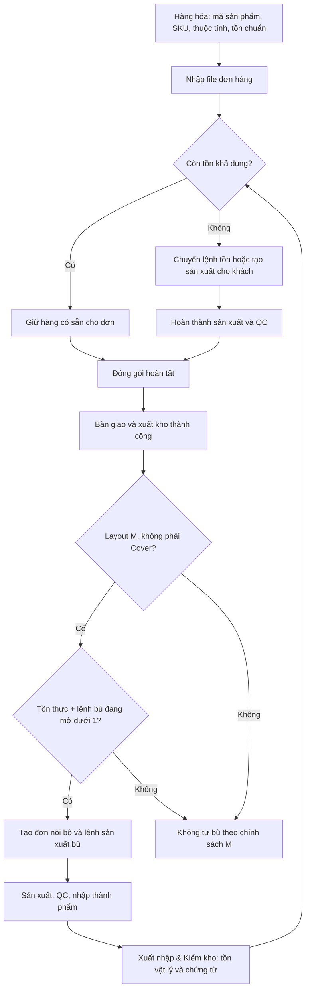

# Luồng tồn chuẩn Layout M — 27/10/2026

Trạng thái: đã push lên Apps Script HEAD/dev ngày 27/10/2026, đối chiếu 29 tệp khớp byte với candidate. Deployment /exec vẫn ở 911 chờ duyệt dev. Chưa chạy nghiệp vụ trên dữ liệu kho thật.

## Quy tắc

- Layout đúng kích thước 30×20×20 cm: minStock = 1 cho từng sản phẩm. Cover cùng kích thước: minStock = 0; không xóa số hàng Cover thực có.
- Chỉ chữ “M” không đủ để suy ra kích thước. Nhận diện bằng kích thước trong tên hoặc mã SKU kết thúc 302020; kích thước rõ trong tên được ưu tiên.
- Nhập đơn: tồn có thể cấp = tồn vật lý − số lượng đang giữ cho các đơn chưa bàn giao. Hàng sản xuất riêng cho khách không giữ chỗ trong tồn thành phẩm.
- Có tồn khả dụng: cấp hàng có sẵn trước. Hết tồn mới chuyển lệnh sản xuất tồn đang chạy sang đơn khách hoặc sản xuất mới. Layout M áp dụng cả đơn xuất khẩu.
- Sau khi lưu đóng gói và bàn giao: số cần bù = max(0, 1 − tồn vật lý − lệnh sản xuất tồn chưa nhập thành phẩm).
- Mỗi sản phẩm thiếu một cái tạo một đơn nội bộ kênh “Sản Xuất Bù Kho” và một lệnh Layout Pending, đủ hai công đoạn; không tự đánh dấu hoàn thành hay tự tăng kho.
- Mã đơn chứa KHO để đi vào nhánh nhập thành phẩm nội bộ của backend hiện hữu. Phiếu IE_TP_<productionId> phân biệt lệnh còn đang bù với lệnh đã nhập kho.
- Gửi lại thao tác không tạo thêm nếu lệnh bù còn mở. Nếu lần ghi trước chỉ tạo được đơn, lần sau khôi phục lệnh trên cùng mã đơn.

## Thay đổi đã kiểm chứng trong mã

`Code.js`: sửa ưu tiên cấp tồn; chỉ tính fulfilledFromStock vào lượng giữ chỗ; áp dụng quét tồn M cho xuất khẩu; gọi chính sách sau ghi dữ liệu trong khóa syncDeltas; lỗi xuất kho không còn bị nuốt để tiếp tục báo bàn giao thành công.

`LayoutStockPolicy.js`: nhận diện tồn chuẩn, tính số cần bù, chống trùng lệnh, khôi phục ghi dở, đọc đầy đủ bảng thay vì cửa sổ 10.000 dòng của UI. `.claspignore` đã bổ sung service này.

`tools/layout-stock-policy.test.js`: kiểm tra quy tắc, hai điều kiện kích hoạt, tồn đủ, Cover, gửi lại, lệnh mở, phiếu nhập thành phẩm, hủy lệnh, ghi dở, phân biệt sản xuất khách và sản xuất kho, tham chiếu mã đơn và ghi service mô phỏng.

Hai tab đã tách trong runtime chuẩn 911; test điều hướng xác nhận. Không biên dịch từ JSX cũ vì chưa đồng bộ với runtime.

## Phần chưa được xác nhận hoặc còn cần sửa

- Đây là mức tồn mục tiêu. Kho có thể về 0 trong thời gian đang sản xuất bù; phần mềm không thể bảo đảm luôn có 1 hàng vật lý nếu chỉ bắt đầu bù sau bàn giao.
- Chưa kiểm chứng trên đơn/file thật; mới push dev. Không tự sửa số lượng kho thật hay sinh lệnh lịch sử hàng loạt.
- Luồng GHN đã nối cùng hàm xuất kho và chính sách bù M. Trạng thái picked/transport/deliver và delivered đều qua bước xuất kho trước khi xác nhận; bù kho chỉ xảy ra khi có đóng gói hoàn tất.
- Xuất kho dùng mã IE_HANDOVER theo id đơn và nhật ký ghi dở trong Script Properties. Lần gọi lại phục hồi giá trị trước/sau, không cộng/trừ delta lần hai; nếu tồn đã đổi không khớp thì dừng để đối chiếu. Đây vẫn không phải giao dịch nguyên tử của cơ sở dữ liệu.
- Đơn lịch sử vốn đã bàn giao không bị trừ lại khi GHN đồng bộ. Khi lỗi kho ở một đơn GHN, giữ trạng thái để thử lại và vẫn hoàn tất ghi sổ các đơn khác đã thành công.
- Báo cáo kiểm toán trước là danh sách cần xác minh, không phải danh sách đã sửa. Kết luận cũ về số dư quỹ cần đính chính: backend đã tự điều chỉnh số dư từ Transactions. Các vấn đề ghi trực tiếp tồn từ màn hàng hóa, import catalog và đảo chứng từ kiểm kho chưa được giải quyết trong bản này.
